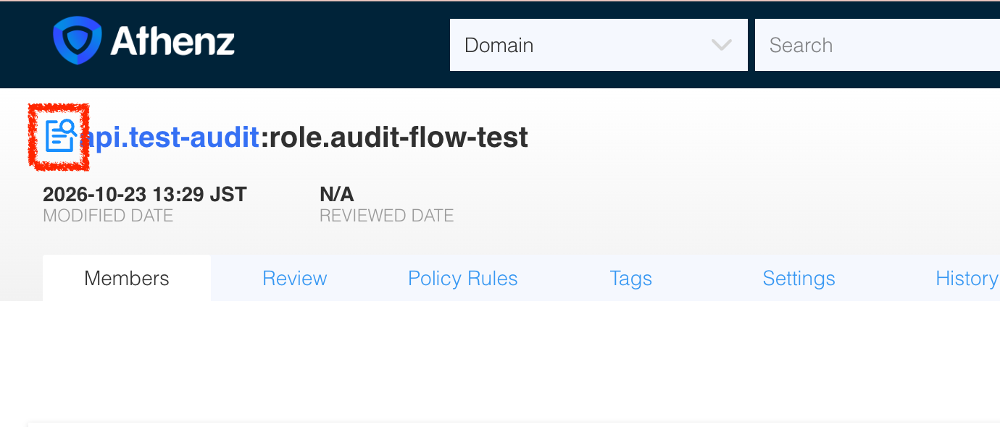

# Goal

Use `human.idjag-learner` to test audit setup and membership approval in `api.test-audit`: attempt each operation without its permission, grant that permission, and retry with the same learner identity.

<!-- TOC depthFrom:2 depthTo:2 -->

- [Step 1. Create the test domain and grant the learner domain administration](#step-1-create-the-test-domain-and-grant-the-learner-domain-administration)
- [Step 2. Create a role with an existing member and inspect its metadata](#step-2-create-a-role-with-an-existing-member-and-inspect-its-metadata)
- [Step 3. Try to enable domain audit as the learner](#step-3-try-to-enable-domain-audit-as-the-learner)
- [Step 4. Grant domain-audit permission and retry as the learner](#step-4-grant-domain-audit-permission-and-retry-as-the-learner)
- [Step 5. Try to enable role audit without its permission](#step-5-try-to-enable-role-audit-without-its-permission)
- [Step 6. Grant role-audit permission and retry as the learner](#step-6-grant-role-audit-permission-and-retry-as-the-learner)
- [Step 7. Submit a membership request from the administrator](#step-7-submit-a-membership-request-from-the-administrator)
- [Step 8. Try to approve without audit approval permission](#step-8-try-to-approve-without-audit-approval-permission)
- [Step 9. Grant audit approval permission to the learner](#step-9-grant-audit-approval-permission-to-the-learner)
- [Step 10. Approve as the learner and confirm membership](#step-10-approve-as-the-learner-and-confirm-membership)
- [Clean-up 11. Remove the test permissions and domain](#clean-up-11-remove-the-test-permissions-and-domain)

<!-- /TOC -->

<details>
<summary>Last verified on Oct 23, 2026 — ✅ Audit setup and approval</summary>

| # | Date | Confirmed Working |
|---|---|---|
| 1 | Oct 23, 2026 | ✅ Human verified — Domain/role audit setup and membership approval: each learner operation failed with 403, then succeeded with 204 after its permission was granted |

The CLI results in Steps 1–10 are captured from the user's Oct 23, 2026 terminal session, except for the UI-opening command's output, which remains an example. The role's audit icon is shown in the supplied screenshot. Clean-up 11 has not been verified; its result blocks remain examples.

This procedure exercises the audit-enabled state that the audit template in [#3493](https://github.com/AthenZ/athenz/pull/3493) depends on. Template expiry/review limits still require their own configuration and verification. The linked `master` design document also describes a later domain-feature-flag option that is absent from the v1.12.48 design.

</details>

# Prerequisites

This tutorial requires the following to be completed:

1. Complete the main [ID-JAG The Hard Way tutorial](https://github.com/mlajkim/id-jag-the-hard-way/tree/main/tutorials), including the `api` domain and the learner identity

Run all commands from the ID-JAG The Hard Way repository root (`idthw/`), using ZMS v1.12.48. Start with the main tutorial's `api` domain, with audit disabled. This procedure uses two existing principals:

| Principal | Purpose in this test | Certificate and key |
|---|---|---|
| `human.idjag-learner` | Tests audit setup and approval before and after receiving the required permissions; also the role's existing approved member | `./keys/idjag-learner.crt`, `./keys/idjag-learner.key` |
| `user.athenz_admin` | Creates the test resources, grants permissions, and submits its own membership request for the learner to approve | `./athenz_dist/certs/athenz_admin.cert.pem`, `./athenz_dist/keys/athenz_admin.private.pem` |

The learner starts without system-metadata or audit-approval permissions. Step 1 grants administration of the test domain; later steps grant the required `update` permissions through dedicated roles and policies. `sys.auth` holds the metadata policies, and `sys.auth.audit.domain` holds the audit approval policy. Both are policy domains; the caller performing the tests remains `human.idjag-learner`.

The shared helpers authenticate as `user.athenz_admin`. The `curl` commands explicitly select the identity being tested. The membership requester and target are both `user.athenz_admin`, so the learner can approve after receiving permission without hitting the separate restriction on approving one's own request or membership.

JSON commands print the complete response with plain `jq`. Commands returning no body use `--include` to print the HTTP status and all headers. Recorded UUIDs, timestamps, and server hostnames belong to the captured run and will differ in later runs.

# Steps

Here is the procedure to get to the goals.

## Step 1. Create the test domain and grant the learner domain administration

As `user.athenz_admin`, create a dedicated subdomain under `api`:

```sh
./tools/athenz/create-subdomain.sh api test-audit
```

```sh
#   ·  Creating Subdomain: api.test-audit...
#   ✔  Subdomain created: api.test-audit
```

Add `human.idjag-learner` to the test domain's `admin` role:

```sh
./tools/athenz/add-role-member.sh \
  api.test-audit \
  admin \
  human.idjag-learner
```

```sh
#   ·  Adding Member human.idjag-learner to Role: api.test-audit:role.admin...
#   ✔  human.idjag-learner  →  api.test-audit:role.admin
```

Use the learner's certificate to confirm it can manage roles in this domain:

```sh
_audit_zms_port=$(./tools/port.sh zms) &&
curl -skS --fail-with-body \
  --cert ./keys/idjag-learner.crt \
  --key ./keys/idjag-learner.key \
  "https://localhost:${_audit_zms_port}/zms/v1/access/update/api.test-audit:role.audit-flow-test" \
  | jq
```

```sh
# {
#   "granted": true
# }
```

This confirms the learner's ordinary domain-admin permission. The following tests distinguish it from the metadata and audit approval permissions granted later.

## Step 2. Create a role with an existing member and inspect its metadata

Create a normal role. With no additional flags, `auditEnabled`, `reviewEnabled`, and `selfServe` are false:

```sh
./tools/athenz/create-role.sh api.test-audit audit-flow-test
```

```sh
#   ·  Creating Role: api.test-audit:role.audit-flow-test...
#   ✔  Role created: api.test-audit:role.audit-flow-test
```

Add `human.idjag-learner` before enabling audit. This gives the role an existing approved member to compare with the new pending member later:

```sh
./tools/athenz/add-role-member.sh \
  api.test-audit \
  audit-flow-test \
  human.idjag-learner
```

```sh
#   ·  Adding Member human.idjag-learner to Role: api.test-audit:role.audit-flow-test...
#   ✔  human.idjag-learner  →  api.test-audit:role.audit-flow-test
```

As the learner, read the role, including pending members:

```sh
_audit_zms_port=$(./tools/port.sh zms) &&
curl -skS --fail-with-body \
  --cert ./keys/idjag-learner.crt \
  --key ./keys/idjag-learner.key \
  "https://localhost:${_audit_zms_port}/zms/v1/domain/api.test-audit/role/audit-flow-test?pending=true" \
  | jq
```

```sh
# {
#   "name": "api.test-audit:role.audit-flow-test",
#   "modified": "2026-10-23T04:26:52.880Z",
#   "roleMembers": [
#     {
#       "memberName": "human.idjag-learner",
#       "approved": true,
#       "requestPrincipal": "user.athenz_admin"
#     }
#   ]
# }
```

Omitted `auditEnabled`, `reviewEnabled`, and `selfServe` use their default value of `false`. The existing member is approved; omitted `active` defaults to `true`.

## Step 3. Try to enable domain audit as the learner

Try to enable audit on the domain using the learner's certificate:

```sh
_audit_zms_port=$(./tools/port.sh zms) &&
curl -skS --fail-with-body \
  --cert ./keys/idjag-learner.crt \
  --key ./keys/idjag-learner.key \
  -X PUT \
  -H 'Content-Type: application/json' \
  -H 'Y-Audit-Ref: learner domain audit activation attempt' \
  --data '{"auditEnabled":true}' \
  "https://localhost:${_audit_zms_port}/zms/v1/domain/api.test-audit/meta/system/auditenabled" \
  | jq
```

```sh
# curl: (22) The requested URL returned error: 403
# {
#   "code": 403,
#   "message": "unauthorized to update system meta attribute: auditenabled"
# }
```

The learner can administer `api.test-audit`, but this operation requires `update` on `sys.auth:meta.domain.auditenabled.api.test-audit`. The specific 403 above demonstrates the permission boundary; a certificate/authentication failure does not.

## Step 4. Grant domain-audit permission and retry as the learner

As `user.athenz_admin`, create a role in `sys.auth` for this test's metadata permissions:

```sh
./tools/athenz/create-role.sh sys.auth test-audit-configurators
```

```sh
#   ·  Creating Role: sys.auth:role.test-audit-configurators...
#   ✔  Role created: sys.auth:role.test-audit-configurators
```

Give this role `update` permission on the test domain's audit setting:

```sh
./tools/athenz/add-policy.sh \
  sys.auth \
  test-audit-configurators \
  update \
  meta.domain.auditenabled.api.test-audit
```

```sh
#   ·  Creating Policy: sys.auth:policy.test-audit-configurators_update_meta_domain_auditenabled_api_test-audit...
#   ✔  Policy created: sys.auth:policy.test-audit-configurators_update_meta_domain_auditenabled_api_test-audit
```

Add the learner to the role:

```sh
./tools/athenz/add-role-member.sh \
  sys.auth \
  test-audit-configurators \
  human.idjag-learner
```

```sh
#   ·  Adding Member human.idjag-learner to Role: sys.auth:role.test-audit-configurators...
#   ✔  human.idjag-learner  →  sys.auth:role.test-audit-configurators
```

Retry the same domain update with the learner's certificate:

```sh
_audit_zms_port=$(./tools/port.sh zms) &&
curl -skS --fail-with-body --include \
  --cert ./keys/idjag-learner.crt \
  --key ./keys/idjag-learner.key \
  -X PUT \
  -H 'Content-Type: application/json' \
  -H 'Y-Audit-Ref: learner domain audit activation attempt' \
  --data '{"auditEnabled":true}' \
  "https://localhost:${_audit_zms_port}/zms/v1/domain/api.test-audit/meta/system/auditenabled"
```

```sh
# HTTP/1.1 204 No Content
# Strict-Transport-Security: max-age=31536000; includeSubDomains
# Host: athenz-zms-server-7479684c78-sxd6d
```

Read the domain metadata as the learner:

```sh
_audit_zms_port=$(./tools/port.sh zms) &&
curl -skS --fail-with-body \
  --cert ./keys/idjag-learner.crt \
  --key ./keys/idjag-learner.key \
  "https://localhost:${_audit_zms_port}/zms/v1/domain/api.test-audit" \
  | jq
```

```sh
# {
#   "org": "ajkimkim",
#   "enabled": true,
#   "auditEnabled": true,
#   "ypmId": 0,
#   "autoDeleteTenantAssumeRoleAssertions": false,
#   "clientIdSelfUpdate": false,
#   "name": "api.test-audit",
#   "modified": "2026-10-23T04:27:29.689Z",
#   "id": "d3f80140-ce99-11f1-b7b1-019ed64e8f49"
# }
```

The same learner operation now succeeds because the policy allows `update` on `sys.auth:meta.domain.auditenabled.api.test-audit`. The domain is audit enabled, but its roles retain their own audit flags. Include `Y-Audit-Ref` in subsequent writes to the audited domain.

## Step 5. Try to enable role audit without its permission

As the learner, try to enable role audit through the system-metadata endpoint. Step 4 granted only domain-metadata permission:

```sh
_audit_zms_port=$(./tools/port.sh zms) &&
curl -skS --fail-with-body \
  --cert ./keys/idjag-learner.crt \
  --key ./keys/idjag-learner.key \
  -X PUT \
  -H 'Content-Type: application/json' \
  -H 'Y-Audit-Ref: learner role audit activation attempt' \
  --data '{"auditEnabled":true}' \
  "https://localhost:${_audit_zms_port}/zms/v1/domain/api.test-audit/role/audit-flow-test/meta/system/auditenabled" \
  | jq
```

```sh
# curl: (22) The requested URL returned error: 403
# {
#   "code": 403,
#   "message": "Forbidden"
# }
```

This endpoint requires `update` on `sys.auth:meta.role.auditenabled.api.test-audit`. Permission on `meta.domain.auditenabled.api.test-audit` does not cover that resource.

The role already has a member, so audit activation uses `/meta/system/auditenabled`. An authorized domain or role administrator can enable audit on an **empty** role through ordinary `/meta` once the domain is audit enabled; ordinary `/meta` rejects audit activation on a populated role.

## Step 6. Grant role-audit permission and retry as the learner

As `user.athenz_admin`, add the role-metadata permission to the learner's existing configurator role:

```sh
./tools/athenz/add-policy.sh \
  sys.auth \
  test-audit-configurators \
  update \
  meta.role.auditenabled.api.test-audit
```

```sh
#   ·  Creating Policy: sys.auth:policy.test-audit-configurators_update_meta_role_auditenabled_api_test-audit...
#   ✔  Policy created: sys.auth:policy.test-audit-configurators_update_meta_role_auditenabled_api_test-audit
```

Retry the same role update with the learner's certificate:

```sh
_audit_zms_port=$(./tools/port.sh zms) &&
curl -skS --fail-with-body --include \
  --cert ./keys/idjag-learner.crt \
  --key ./keys/idjag-learner.key \
  -X PUT \
  -H 'Content-Type: application/json' \
  -H 'Y-Audit-Ref: learner role audit activation attempt' \
  --data '{"auditEnabled":true}' \
  "https://localhost:${_audit_zms_port}/zms/v1/domain/api.test-audit/role/audit-flow-test/meta/system/auditenabled"
```

```sh
# HTTP/1.1 204 No Content
# Strict-Transport-Security: max-age=31536000; includeSubDomains
# Host: athenz-zms-server-7479684c78-sxd6d
```

Read the full role metadata as the learner:

```sh
_audit_zms_port=$(./tools/port.sh zms) &&
curl -skS --fail-with-body \
  --cert ./keys/idjag-learner.crt \
  --key ./keys/idjag-learner.key \
  "https://localhost:${_audit_zms_port}/zms/v1/domain/api.test-audit/role/audit-flow-test?pending=true" \
  | jq
```

```sh
# {
#   "auditEnabled": true,
#   "name": "api.test-audit:role.audit-flow-test",
#   "modified": "2026-10-23T04:28:10.190Z",
#   "roleMembers": [
#     {
#       "memberName": "human.idjag-learner",
#       "approved": true,
#       "requestPrincipal": "user.athenz_admin"
#     }
#   ]
# }
```

The role now has `auditEnabled=true`. The existing member remains approved: enabling audit does not turn existing approved memberships into pending requests. If an audit template is configured, this operation can also reduce expiry/review settings and adjust existing members' due dates.

Open the role in the Athenz UI and confirm that the audit icon now appears next to its name:

```sh
_audit_ui_port=$(./tools/port.sh athenz-ui) &&
./tools/open.sh "http://localhost:${_audit_ui_port}/domain/api.test-audit/role/audit-flow-test/members"
```

```sh
#   ✔  Opened: http://localhost:3000/domain/api.test-audit/role/audit-flow-test/members
```



## Step 7. Submit a membership request from the administrator

As `user.athenz_admin`, request its own membership in `audit-flow-test`. This account already administers the test domain, so it can submit the change. `selfServe` and `reviewEnabled` remain false; the role's `auditEnabled=true` makes the addition require approval:

```sh
_audit_zms_port=$(./tools/port.sh zms) &&
curl -skS --fail-with-body \
  --cert ./athenz_dist/certs/athenz_admin.cert.pem \
  --key ./athenz_dist/keys/athenz_admin.private.pem \
  -X PUT \
  -H 'Content-Type: application/json' \
  -H 'Athenz-Return-Object: true' \
  -H 'Y-Audit-Ref: request administrator audit membership' \
  --data '{"memberName":"user.athenz_admin","roleName":"audit-flow-test"}' \
  "https://localhost:${_audit_zms_port}/zms/v1/domain/api.test-audit/role/audit-flow-test/member/user.athenz_admin" \
  | jq
```

```sh
# {
#   "memberName": "user.athenz_admin",
#   "isMember": true,
#   "roleName": "api.test-audit:role.audit-flow-test",
#   "approved": false,
#   "requestPrincipal": "user.athenz_admin",
#   "pendingState": "ADD"
# }
```

The addition becomes a pending request even though a domain administrator submitted it. `approved=false` and `pendingState="ADD"` identify that state. The JDBC response can contain `isMember=true` for a pending record; it does not grant active membership.

As the learner, read the role with `pending=true` to compare its existing approved membership with the administrator's new pending membership:

```sh
_audit_zms_port=$(./tools/port.sh zms) &&
curl -skS --fail-with-body \
  --cert ./keys/idjag-learner.crt \
  --key ./keys/idjag-learner.key \
  "https://localhost:${_audit_zms_port}/zms/v1/domain/api.test-audit/role/audit-flow-test?pending=true" \
  | jq
```

```sh
# {
#   "auditEnabled": true,
#   "name": "api.test-audit:role.audit-flow-test",
#   "modified": "2026-10-23T04:28:24.215Z",
#   "roleMembers": [
#     {
#       "memberName": "human.idjag-learner",
#       "approved": true,
#       "requestPrincipal": "user.athenz_admin"
#     },
#     {
#       "memberName": "user.athenz_admin",
#       "active": false,
#       "approved": false,
#       "auditRef": "request administrator audit membership",
#       "requestTime": "2026-10-23T04:28:24.214Z",
#       "pendingState": "ADD"
#     }
#   ]
# }
```

## Step 8. Try to approve without audit approval permission

As the learner, try to approve `user.athenz_admin`'s pending membership:

```sh
_audit_zms_port=$(./tools/port.sh zms) &&
curl -skS --fail-with-body \
  --cert ./keys/idjag-learner.crt \
  --key ./keys/idjag-learner.key \
  -X PUT \
  -H 'Content-Type: application/json' \
  -H 'Y-Audit-Ref: learner audit approval attempt' \
  --data '{"memberName":"user.athenz_admin","roleName":"audit-flow-test","approved":true,"active":true}' \
  "https://localhost:${_audit_zms_port}/zms/v1/domain/api.test-audit/role/audit-flow-test/member/user.athenz_admin/decision" \
  | jq
```

```sh
# curl: (22) The requested URL returned error: 403
# {
#   "code": 403,
#   "message": "principal human.idjag-learner is not authorized to approve / reject members"
# }
```

The learner can administer `api.test-audit` and change its audit metadata, but those permissions do not grant audit approval. The request remains pending. The learner is neither the requester nor the target member, so this test isolates the missing approval permission.

## Step 9. Grant audit approval permission to the learner

As `user.athenz_admin`, create a dedicated approver role in `sys.auth.audit.domain`:

```sh
./tools/athenz/create-role.sh sys.auth.audit.domain test-audit-approvers
```

```sh
#   ·  Creating Role: sys.auth.audit.domain:role.test-audit-approvers...
#   ✔  Role created: sys.auth.audit.domain:role.test-audit-approvers
```

Grant this role `update` on `sys.auth.audit.domain:audit.api.test-audit`:

```sh
./tools/athenz/add-policy.sh \
  sys.auth.audit.domain \
  test-audit-approvers \
  update \
  audit.api.test-audit
```

```sh
#   ·  Creating Policy: sys.auth.audit.domain:policy.test-audit-approvers_update_audit_api_test-audit...
#   ✔  Policy created: sys.auth.audit.domain:policy.test-audit-approvers_update_audit_api_test-audit
```

Add the learner to the approver role:

```sh
./tools/athenz/add-role-member.sh \
  sys.auth.audit.domain \
  test-audit-approvers \
  human.idjag-learner
```

```sh
#   ·  Adding Member human.idjag-learner to Role: sys.auth.audit.domain:role.test-audit-approvers...
#   ✔  human.idjag-learner  →  sys.auth.audit.domain:role.test-audit-approvers
```

With the learner's certificate, check the exact permission used by the approval API:

```sh
_audit_zms_port=$(./tools/port.sh zms) &&
curl -skS --fail-with-body \
  --cert ./keys/idjag-learner.crt \
  --key ./keys/idjag-learner.key \
  "https://localhost:${_audit_zms_port}/zms/v1/access/update/sys.auth.audit.domain:audit.api.test-audit" \
  | jq
```

```sh
# {
#   "granted": true
# }
```

The role name is arbitrary; its policy supplies the approval permission. The default `sys.auth.audit.domain:role.admin` can also provide this permission through its admin policy. This tutorial uses a dedicated role to grant approval for `api.test-audit` explicitly. Organization-level approval can alternatively come from a matching policy in `sys.auth.audit.org`.

## Step 10. Approve as the learner and confirm membership

Repeat Step 8 with the same learner certificate, endpoint, and approval payload:

```sh
_audit_zms_port=$(./tools/port.sh zms) &&
curl -skS --fail-with-body --include \
  --cert ./keys/idjag-learner.crt \
  --key ./keys/idjag-learner.key \
  -X PUT \
  -H 'Content-Type: application/json' \
  -H 'Y-Audit-Ref: learner audit approval attempt' \
  --data '{"memberName":"user.athenz_admin","roleName":"audit-flow-test","approved":true,"active":true}' \
  "https://localhost:${_audit_zms_port}/zms/v1/domain/api.test-audit/role/audit-flow-test/member/user.athenz_admin/decision"
```

```sh
# HTTP/1.1 204 No Content
# Strict-Transport-Security: max-age=31536000; includeSubDomains
# Host: athenz-zms-server-7479684c78-sxd6d
```

Read the membership as the learner:

```sh
_audit_zms_port=$(./tools/port.sh zms) &&
curl -skS --fail-with-body \
  --cert ./keys/idjag-learner.crt \
  --key ./keys/idjag-learner.key \
  "https://localhost:${_audit_zms_port}/zms/v1/domain/api.test-audit/role/audit-flow-test/member/user.athenz_admin" \
  | jq
```

```sh
# {
#   "memberName": "user.athenz_admin",
#   "isMember": true,
#   "roleName": "api.test-audit:role.audit-flow-test",
#   "approved": true,
#   "requestPrincipal": "user.athenz_admin"
# }
```

The membership is now approved, and `pendingState` is absent. `requestPrincipal` still identifies the original requester, `user.athenz_admin`; the learner performed the approval. Audit approval always requires an authorized principal who is different from both the requester and the target member.

## Clean-up 11. Remove the test permissions and domain

As `user.athenz_admin`, remove the three policies created by this tutorial. This revokes the learner's test-specific metadata and approval permissions:

```sh
./tools/athenz/delete-policy.sh \
  sys.auth \
  test-audit-configurators_update_meta_domain_auditenabled_api_test-audit &&
./tools/athenz/delete-policy.sh \
  sys.auth \
  test-audit-configurators_update_meta_role_auditenabled_api_test-audit &&
./tools/athenz/delete-policy.sh \
  sys.auth.audit.domain \
  test-audit-approvers_update_audit_api_test-audit
```

```sh
#   ·  Deleting policy sys.auth:policy.test-audit-configurators_update_meta_domain_auditenabled_api_test-audit...
#   ✔  Policy deleted or already absent: sys.auth:policy.test-audit-configurators_update_meta_domain_auditenabled_api_test-audit
#   ·  Deleting policy sys.auth:policy.test-audit-configurators_update_meta_role_auditenabled_api_test-audit...
#   ✔  Policy deleted or already absent: sys.auth:policy.test-audit-configurators_update_meta_role_auditenabled_api_test-audit
#   ·  Deleting policy sys.auth.audit.domain:policy.test-audit-approvers_update_audit_api_test-audit...
#   ✔  Policy deleted or already absent: sys.auth.audit.domain:policy.test-audit-approvers_update_audit_api_test-audit
```

Delete the two dedicated roles and their learner memberships:

```sh
./tools/athenz/delete-role.sh sys.auth test-audit-configurators &&
./tools/athenz/delete-role.sh sys.auth.audit.domain test-audit-approvers
```

```sh
#   ·  Deleting role sys.auth:role.test-audit-configurators...
#   ✔  Role deleted or already absent: sys.auth:role.test-audit-configurators
#   ·  Deleting role sys.auth.audit.domain:role.test-audit-approvers...
#   ✔  Role deleted or already absent: sys.auth.audit.domain:role.test-audit-approvers
```

Delete `api.test-audit`, including its test role, memberships, and the learner's temporary domain-admin membership:

```sh
_audit_zms_port=$(./tools/port.sh zms) &&
curl -skS --fail-with-body --include \
  --cert ./athenz_dist/certs/athenz_admin.cert.pem \
  --key ./athenz_dist/keys/athenz_admin.private.pem \
  -X DELETE \
  -H 'Y-Audit-Ref: clean up audit research domain' \
  "https://localhost:${_audit_zms_port}/zms/v1/subdomain/api/test-audit"
```

```sh
# HTTP/1.1 204 No Content
```

# Reference

- [Audit Template design — current master](https://github.com/AthenZ/athenz/blob/master/docs/design/audit_template.md)
- [Audit Template design — v1.12.48](https://github.com/AthenZ/athenz/blob/v1.12.48/docs/design/audit_template.md)
- [#3493 — Audit template support for audit-enabled objects](https://github.com/AthenZ/athenz/pull/3493)
- [Domain system metadata and subdomain APIs](https://github.com/AthenZ/athenz/blob/v1.12.48/core/zms/src/main/rdl/Domain.rdli)
- [Role metadata, membership, and approval APIs](https://github.com/AthenZ/athenz/blob/v1.12.48/core/zms/src/main/rdl/Role.rdli)
- [Domain system-metadata authorization](https://github.com/AthenZ/athenz/blob/v1.12.48/servers/zms/src/main/java/com/yahoo/athenz/zms/ZMSImpl.java#L3211)
- [Role system-metadata permission](https://github.com/AthenZ/athenz/blob/v1.12.48/core/zms/src/main/rdl/Role.rdli#L254)
- [HTTP authorization failure response](https://github.com/AthenZ/athenz/blob/v1.12.48/libs/java/server_common/src/main/java/com/yahoo/athenz/common/server/rest/Http.java#L191)
- [Ordinary role-metadata audit validation](https://github.com/AthenZ/athenz/blob/v1.12.48/servers/zms/src/main/java/com/yahoo/athenz/zms/ZMSImpl.java#L10883)
- [Audit membership approval and separation of requester and approver](https://github.com/AthenZ/athenz/blob/v1.12.48/servers/zms/src/main/java/com/yahoo/athenz/zms/ZMSImpl.java#L11076)
- [Default admin policy](https://github.com/AthenZ/athenz/blob/v1.12.48/servers/zms/src/main/java/com/yahoo/athenz/zms/utils/ZMSUtils.java#L75)
- [Pending state for audit-enabled membership additions](https://github.com/AthenZ/athenz/blob/v1.12.48/servers/zms/src/main/java/com/yahoo/athenz/zms/ZMSImpl.java#L11278)
- [Role system-metadata updates and existing member due dates](https://github.com/AthenZ/athenz/blob/v1.12.48/servers/zms/src/main/java/com/yahoo/athenz/zms/DBService.java#L6944)
