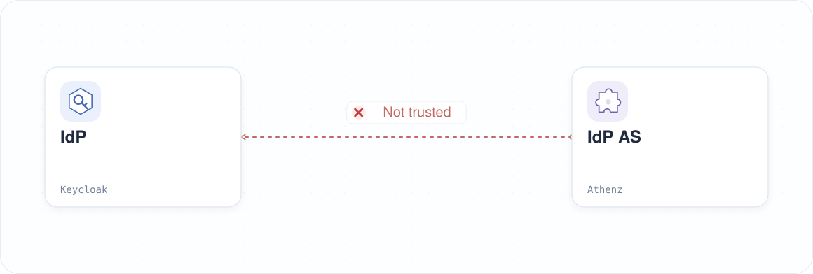

|                    Previous                    |                Current                |                      Next                      |
|:----------------------------------------------:|:-------------------------------------:|:----------------------------------------------:|
| [Identity Provider](./12-identity-provider.md) | **Trusted Identity Provider — Codex** | [AI Client Gateway](./14-ai-client-gateway.md) |

# Trusted Identity Provider — Codex

As an Authorization Server, Athenz cannot accept ID tokens from just any Identity Provider (IdP). An Athenz administrator must explicitly configure which IdPs it trusts.

In the previous chapter, you deployed Keycloak, but Athenz does not yet trust it. In this chapter, you will configure Athenz to trust Keycloak and validate its ID tokens so they can be exchanged for ID-JAGs.

<!-- TOC depthFrom:2 depthTo:2 -->

- [Understand the Trust Configuration](#understand-the-trust-configuration)
- [Install Plugin into the ZTS Server](#install-plugin-into-the-zts-server)
- [Connect Keycloak with the Plugin](#connect-keycloak-with-the-plugin)
- [Configure ZTS to Load the Plugin](#configure-zts-to-load-the-plugin)
- [Review the Result](#review-the-result)
- [Next Steps](#next-steps)

<!-- /TOC -->

<a id="understand-what-we-need-to-do"></a>

## Understand the Trust Configuration

This deployment is not yet configured to trust Keycloak. To exchange a Keycloak ID token for an ID-JAG, you need to:

1. Install a plugin that teaches Athenz how to validate Keycloak tokens.
2. Provide the plugin with Keycloak's `jwks_uri` so it can verify token signatures.
3. Tell the ZTS server where to find the plugin configuration.



## Install Plugin into the ZTS Server

Apply the patch that mounts the Keycloak token exchange provider JAR into the ZTS server:

```sh
kubectl patch deployment athenz-zts-server \
  -n athenz \
  --patch-file components/keycloak_token_exchange_provider/hack/static/zts-plugin-jar-mount-patch.yaml
```

```sh
# deployment.apps/athenz-zts-server patched
```

Wait for the rollout:

```sh
kubectl rollout status deployment/athenz-zts-server -n athenz
```

```sh
# Waiting for deployment "athenz-zts-server" rollout to finish: 0 of 1 updated replicas are available...
# deployment "athenz-zts-server" successfully rolled out
```

Verify the JAR was mounted:

```sh
kubectl -n athenz exec deployment/athenz-zts-server \
  -c athenz-zts-server \
  -- sh -c "ls -al /opt/athenz/zts/lib/jars | grep keycloak"
```

```sh
# -rw-r--r-- 1 root root 3237 May 1 14:26 keycloak-token-provider.jar
```

We have now mounted the `KeycloakTokenExchangeProvider` plugin JAR in the ZTS server:


## Connect Keycloak with the Plugin

Create a `providers.json` ConfigMap that points the plugin at our Keycloak instance:

```sh
cat <<EOF | kubectl apply -f -
apiVersion: v1
kind: ConfigMap
metadata:
  name: zts-providers-config
  namespace: athenz
data:
  providers.json: |
    [
      {
        "issuerUri": "http://localhost:$(./tools/port.sh keycloak)/realms/master",
        "jwksUri": "http://keycloak.idp:8080/realms/master/protocol/openid-connect/certs",
        "providerClassName": "com.mlajkim.athenz.KeycloakTokenExchangeProvider"
      }
    ]
EOF
```

```sh
# configmap/zts-providers-config created
```

Verify the ZTS server can reach Keycloak's JWKS endpoint:

```sh
kubectl -n athenz exec deployment/athenz-zts-server -c athenz-zts-server -- \
  sh -c "curl -k http://keycloak.idp:8080/realms/master/protocol/openid-connect/certs | jq ."
```

The response should contain a nonempty `keys` array. This example omits the remaining key fields; key IDs and the number of keys vary by environment:

```sh
# {
#   "keys": [
#     {
#       "kid": "<key-id>",
#       ...
#     }
#   ]
# }
```

Mount the ConfigMap into the ZTS server:

```sh
kubectl patch deployment athenz-zts-server \
  -n athenz \
  --patch-file components/keycloak_token_exchange_provider/hack/static/zts-providers-config-patch.yaml
```

```sh
# deployment.apps/athenz-zts-server patched
```

Verify the file is present inside the container:

```sh
kubectl -n athenz exec deployment/athenz-zts-server \
  -c athenz-zts-server \
  -- sh -c "cat /opt/athenz/zts/conf/providers.json"
```

```sh
# [
#   {
#     "issuerUri": "http://localhost:34443/realms/master",
#     "jwksUri": "http://keycloak.idp:8080/realms/master/protocol/openid-connect/certs",
#     "providerClassName": "com.mlajkim.athenz.KeycloakTokenExchangeProvider"
#   }
# ]
```

## Configure ZTS to Load the Plugin

Mounting the file is not enough — we must tell the ZTS server where to look for it. Edit the ZTS ConfigMap with `kubectl edit`:

```sh
KUBE_EDITOR=vim kubectl edit configmap athenz-zts-conf -n athenz
```

Follow these steps inside `vim`:

1. Type `/zts.prop` and press **Enter** to jump to the properties section.
2. Press `o` to open a new line below in Insert mode.
3. Press **Space** four times to indent the line by four spaces (if Vim adds indentation automatically, adjust it to four spaces in total)
4. Paste the following line:

```
athenz.zts.oauth_provider_config_file=/opt/athenz/zts/conf/providers.json
```


5. Press **Esc**, then type `:wq!` and press **Enter** to save.

You should see:

```sh
# configmap/athenz-zts-conf edited
```

Restart the ZTS server to load the new configuration:

```sh
kubectl -n athenz rollout restart deployment athenz-zts-server
```

```sh
# deployment.apps/athenz-zts-server restarted
```

Wait for the rollout:

```sh
kubectl rollout status deployment/athenz-zts-server -n athenz
```

```sh
# Waiting for deployment "athenz-zts-server" rollout to finish: 0 of 1 updated replicas are available...
# deployment "athenz-zts-server" successfully rolled out
```

Verify the configuration was picked up:

```sh
kubectl logs -n athenz deployment/athenz-zts-server -c athenz-zts-server | grep "oauth_provider_config_file"
```

```sh
# 12:34:56.233 [main] INFO  c.y.a.c.s.util.config.ConfigManager - configuration "athenz.zts.oauth_provider_config_file" created
```

> [!NOTE]
> The plugin maps the `preferred_username` claim from the Keycloak token to the Athenz principal `human.[preferred_username]`. So `idjag-learner` in Keycloak becomes `human.idjag-learner` in Athenz.

<a id="review-summary-of-changes"></a>

## Review the Result

We installed the `KeycloakTokenExchangeProvider` plugin. It takes a Keycloak ID token, verifies the signature with Keycloak's public keys and validates the token claims, and returns the authenticated Athenz principal:


<a id="whats-next"></a>

## Next Steps

Athenz now trusts Keycloak ID tokens. In the next chapter, you will deploy AI Client Gateway to connect Codex CLI to Keycloak for sign-in.

Next: [AI Client Gateway](./14-ai-client-gateway.md)
